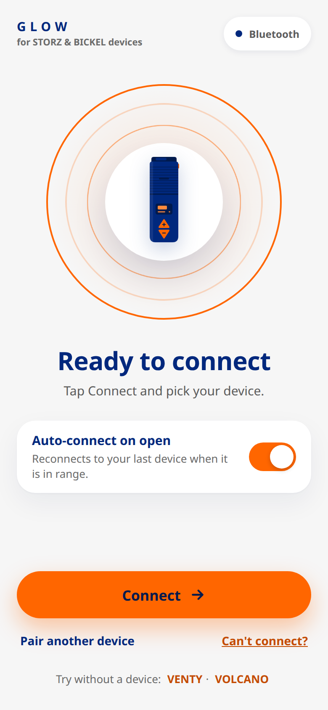
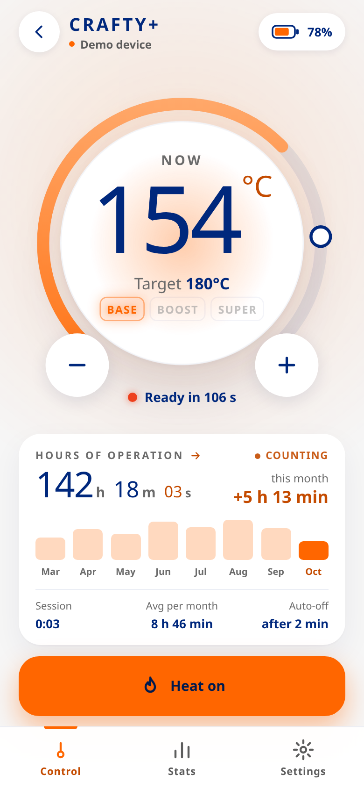
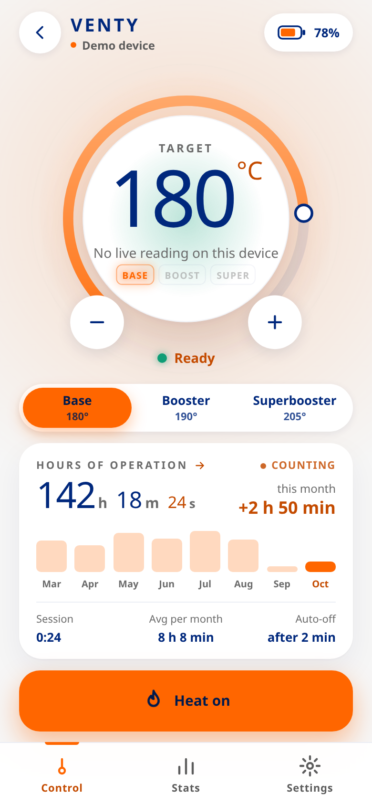
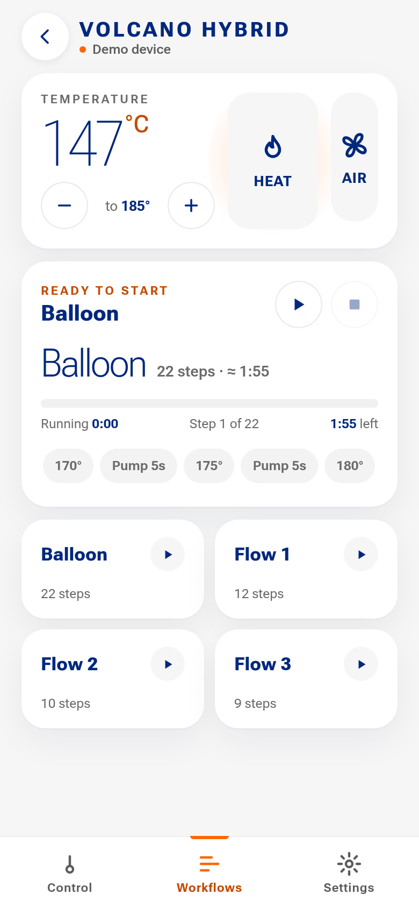
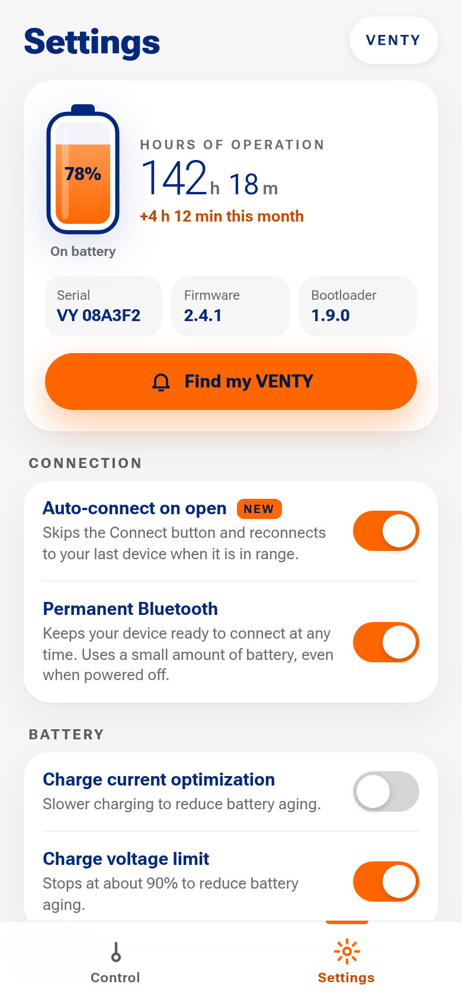
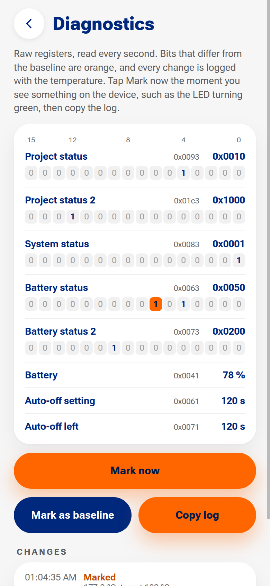

<div align="center">


# Glow

**An unofficial Android app for STORZ & BICKEL Bluetooth vaporizers**

VENTY · VEAZY · CRAFTY · CRAFTY+ · VOLCANO HYBRID

[](../../releases/latest)


**[Download the latest APK](../../releases/latest)**

</div>

<table>
  <tr>
    <td align="center"><br><sub>Connect</sub></td>
    <td align="center"><br><sub>CRAFTY+ heating</sub></td>
    <td align="center"><br><sub>VENTY ready</sub></td>
  </tr>
  <tr>
    <td align="center"><br><sub>VOLCANO workflows</sub></td>
    <td align="center"><br><sub>Settings</sub></td>
    <td align="center"><br><sub>Device diagnostics</sub></td>
  </tr>
</table>

<sub>Screenshots from demo mode: <code>npm run dev</code>, then <code>/?demo=venty</code>, <code>/?demo=crafty</code> or <code>/?demo=volcano</code>.</sub>

## Features

- 🔗 **Reconnects on its own.** Glow remembers your device and reconnects when you open it: no
  Connect button, no device picker. On the first start it asks once for the Nearby devices
  permission and connects to the only device in range.
- 🔒 **Runs entirely on the phone.** No server, account, analytics or CDN; the app talks to the
  device over Bluetooth only, and its Content-Security-Policy blocks every network request.
- 🌡️ **Dashboard.** A temperature dial that glows red while heating and green when ready, a status
  line that mirrors the device LED, time to ready, Booster / Superbooster, and lifetime hours of
  operation counting up live, with usage per month.
- 🔋 **Battery.** Level, charging and charged, with the charge animating up to full.
- 🌋 **VOLCANO workflows.** Flow 1–3 and Balloon run from the phone, step by step, with time
  running and time left.
- ⚙️ **Settings.** Every device setting the official web app offers, plus Find My and the
  Booster / Superbooster offsets. Sliders mark the factory value where STORZ & BICKEL documents
  one. Firmware update, factory reset and analysis are left out on purpose.
- 🧪 **Device diagnostics.** Live raw registers with changed bits highlighted and a copyable
  change log, for working out what undocumented bits mean.
- 🎮 **Demo mode.** "Try without a device" on the Connect screen simulates a VENTY or a VOLCANO.

## Supported devices

Only the **CRAFTY+** (firmware V03.24) has been tried on a real device so far. Everything else is
built from the protocol and covered by unit tests.

<sub>✅ tried on a real device · ✓ supported · — not available on that device</sub>

| | VENTY | VEAZY | CRAFTY+ | CRAFTY ≥ V02.51 | CRAFTY < V02.51 | VOLCANO HYBRID |
|---|:---:|:---:|:---:|:---:|:---:|:---:|
| Auto-connect | ✓ | ✓ | ✅ | ✓ | ✓ | ✓ |
| Temperature and target | ✓ | ✓ | ✅ | ✓ | ✓ | ✓ |
| Heater on / off from the app | ✓ | ✓ | ✅ | ✓ | —¹ | ✓ |
| Status mirrors the LED | ✓ | ✓ | ✅ | ✓ | ✓ | ✓² |
| Booster / Superbooster | ✓ | ✓ | ✅³ | ✓³ | ✓³ | — |
| Booster / Superbooster offsets | ✓ | ✓ | ✓⁴ | ✓⁴ | ✓⁴ | — |
| Battery level | ✓ | ✓ | ✅ | ✓ | ✓ | — |
| Charging / charged | ✓ | ✓ | ✅ | ✓⁵ | — | — |
| Hours of operation, usage per month | ✓ | ✓ | ✅ | ✓ | ✓ | ✓ |
| Auto-off countdown | ✓ | ✓ | ✓ | ✓ | — | ✓ |
| Air pump | — | — | — | — | — | ✓ |
| Workflows (Flow 1–3, Balloon) | — | — | — | — | — | ✓ |
| Find My | ✓ | ✓ | ✓ | — | — | — |
| Device settings | ✓ | ✓ | ✓ | ✓ | ✓ | ✓ |
| Device diagnostics | — | — | ✅ | ✓ | ✓ | — |

<sub>
¹ Only with the device's own button. ·
² No ready flag; ready means within 1 °C of the target. ·
³ A readout: CRAFTY switches levels only with its own button; older CRAFTY has no Superbooster. ·
⁴ The Booster offset only; the CRAFTY+ Superbooster is always 15 °C above it. ·
⁵ Uses the bit found on a CRAFTY+, not yet confirmed on this firmware.
</sub>

**Not supported:** MIGHTY and MIGHTY+. The official web app that Glow's drivers are based on has
no protocol for them.

## Help test your device

Own a VENTY, VEAZY, VOLCANO HYBRID or another CRAFTY? Try Glow on it and
[send a device report](../../issues/new?template=device-report.yml): your firmware, and which
rows of the table above work. Fixes are welcome as pull requests; [CONTRIBUTING.md](CONTRIBUTING.md)
covers testing, building a debug APK and changing a driver.

## Install

1. Open the [latest release](../../releases/latest) on your phone and download the `glow-*.apk`.
2. Open it. Android asks once to allow installs from your browser.
3. Later releases install over it and keep your data (every release is signed with the same key).

## Development

### Build

Requires Node 22, plus JDK 21 and the Android SDK (platform 36) for the APK.

```sh
npm ci
npm run dev                 # browser, open /?demo=venty, /?demo=volcano or /?demo=crafty
npx svelte-check --tsconfig ./tsconfig.json
npm test                    # protocol driver tests
npm run android:sync        # web build + copy into android/
cd android && ./gradlew assembleDebug
```

The debug APK (`android/app/build/outputs/apk/debug/`) installs as **Glow debug**, next to a
release install. Release APKs are signed in CI only; see [CONTRIBUTING.md](CONTRIBUTING.md).

### CI and releases

GitHub Actions checks every change and builds the releases:

- **Pull requests and every push** (`.github/workflows/check.yml`, no secrets): svelte-check,
  tests, the web build and a debug APK kept as a workflow artifact, for testers to try.
- **Push to `main`** (`.github/workflows/android.yml`, never run for pull requests): builds a
  signed APK and a signed App Bundle (`glow-*.aab`) and keeps both as workflow artifacts.
  Only the APK goes on GitHub releases, so Obtainium keeps finding a single `glow-*.apk`.
- **Tag `v*`** (for example `git tag v0.2.0 && git push --tags`): also publishes a
  GitHub release with the APK attached and, once the `PLAY_SERVICE_ACCOUNT_JSON`
  secret is set, uploads the bundle to the Google Play internal track (skipped
  without it). The first bundle has to be uploaded by hand in Play Console.
- **Screens** (`.github/workflows/screens.yml`, run by hand): boots Android 12 and 15
  emulators and screenshots a debug build, to check layout and system bars before a
  release.

The signing key lives in the repository secrets `GLOW_KEYSTORE_BASE64` and
`GLOW_KEYSTORE_PASSWORD`, plus offline backups. Every release has to be signed
with the same key, or Android refuses to update the installed app. For the same
reason Play App Signing uses this key too ("Export and upload a key from Java
keystore", with Google's PEPK tool) rather than one Google generates, so Play
installs and GitHub APKs share one signature and update each other.

### Layout

| Path | What |
|---|---|
| `src/lib/devices/` | Protocol drivers: `qvap.ts` (VENTY/VEAZY), `volcano.ts`, `crafty.ts`, plus `demo.ts` |
| `docs/protocol/` | Protocol notes per device family: services, payloads, open questions |
| `src/lib/ble/` | Bluetooth: the native plugin on Android, Web Bluetooth in a browser |
| `src/lib/connection.svelte.ts` | Auto-connect, scanning, reconnecting, commands |
| `src/lib/usage.svelte.ts` | Hours-of-operation history, session time, time to ready |
| `src/lib/workflow.svelte.ts` | The VOLCANO workflow runner |
| `src/screens/`, `src/components/` | The UI (Svelte 5) |
| `assets/src/` | Icon and splash sources (`node scripts/render-assets.mjs && npx capacitor-assets generate --android`) |

### How the drivers were made

The protocol drivers were written from the protocol used by the official web app at
app.storz-bickel.com and cross-checked against open-source projects; `docs/protocol/` has the
notes per device family, including what was found on real hardware. They have unit tests
(`npm test`).

---

<sub>Glow is not made, endorsed or supported by STORZ & BICKEL. STORZ & BICKEL, VENTY, VEAZY,
CRAFTY, VOLCANO and MIGHTY are trademarks of their owner.</sub>
